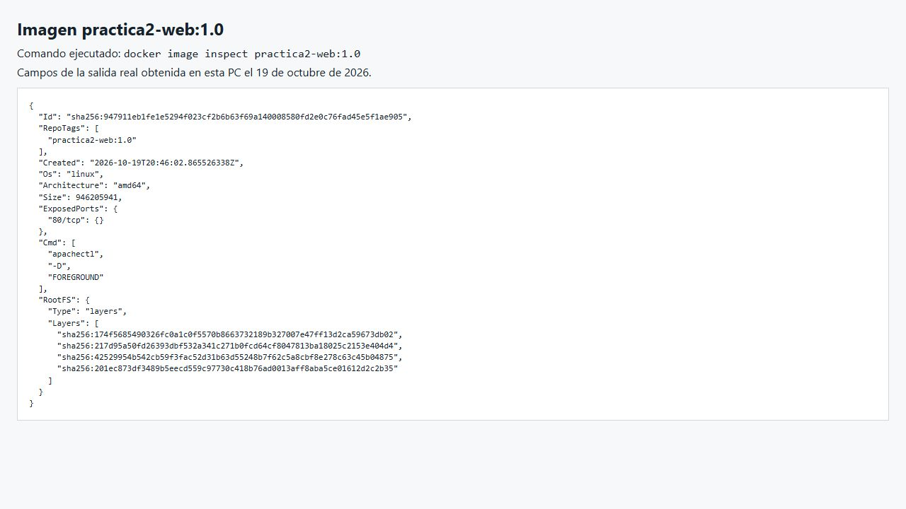
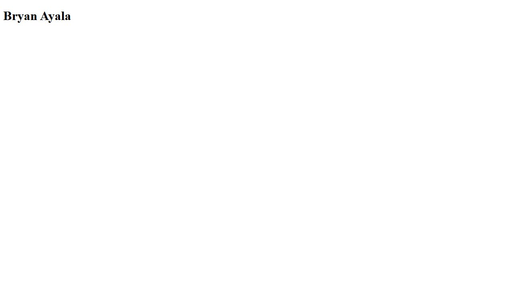

# Dockerfile
Un Dockerfile es un archivo de texto plano que contiene una serie de instrucciones que Docker utiliza para construir una imagen de contenedor Docker. Este conjunto de instrucciones define cómo se debe configurar y construir una imagen de contenedor, incluyendo qué sistema operativo base usar, qué software instalar, qué archivos copiar en el contenedor y cómo configurar el entorno de ejecución.
 


Tradicionalmente, el archivo docker no tiene extensión. Simplemente se denomina Dockerfile sin ningún tipo de extensión. Adicionalmente, los Dockerfiles pueden ser creados usando la extensión .dockerfile. Esto se utiliza cuando hay una necesidad de almacenar múltiples archivos docker en un solo directorio.
Las instrucciones en un Dockerfile son simples y están diseñadas para ser leídas y comprendidas fácilmente. 

### FROM 
Especifica la imagen base que se utilizará como punto de partida para construir la nueva imagen de Docker. Por ejemplo, FROM nginx:alpine significa que la nueva imagen se basará en la imagen oficial de Nginx que está etiquetada como "alpine". Al utilizar una imagen base existente, se heredan todas las configuraciones y software incluidos en esa imagen, lo que facilita la creación de nuevas imágenes sin tener que empezar desde cero.

### RUN
Ejecuta comandos en el contenedor durante el proceso de construcción de la imagen. Puedes usar esta instrucción para instalar software, configurar el entorno, o realizar cualquier otra tarea necesaria para preparar la imagen. Por ejemplo, RUN apt-get update && apt-get install -y <paquete> instalará un paquete utilizando el administrador de paquetes apt en una imagen basada en Ubuntu.

### COPY
Copia archivos o directorios desde la máquina host al sistema de archivos del contenedor. Se utiliza para agregar archivos, scripts u otros recursos necesarios para la aplicación en la imagen de contenedor. Por ejemplo, COPY ./mi-app /app copiará el directorio mi-app desde la máquina host al directorio /app en el contenedor.

### ADD
Copia archivos o directorios desde el sistema de archivos de la máquina host al sistema de archivos del contenedor. Aunque es similar a la instrucción COPY, ADD tiene algunas características adicionales, como la capacidad de descomprimir automáticamente archivos y de copiar archivos desde una URL remota.

### CMD 
Define el comando predeterminado que se ejecutará cuando se inicie el contenedor. Si se proporciona más de una instrucción CMD, solo la última tendrá efecto. Por ejemplo, CMD ["nginx", "-g", "daemon off;"] ejecutará Nginx en primer plano cuando se inicie el contenedor.

### ENTRYPOINT
Configura el comando o el script que se ejecutará cuando se inicie un contenedor basado en la imagen. CMD se puede reemplazar indicando otro comando después del nombre de la imagen. ENTRYPOINT se puede reemplazar con `docker run --entrypoint`.
Con ENTRYPOINT en formato JSON, lo que se escribe después de la imagen se pasa como argumentos al ejecutable y reemplaza los argumentos predeterminados de CMD.

### EXPOSE
Documenta el puerto que usa la aplicación dentro del contenedor. `EXPOSE 80` no publica el puerto en el host. Para entrar desde el host se usa `-p`, o `-P` para publicar automáticamente los puertos declarados con EXPOSE.

### ENV
Define variables de entorno dentro del contenedor. Las variables de entorno definidas con ENV estarán disponibles para cualquier proceso en el contenedor durante su ejecución. Por ejemplo, ENV MYSQL_ROOT_PASSWORD=password define una variable de entorno llamada MYSQL_ROOT_PASSWORD con el valor password.

### VOLUME 
Esta instrucción se se utiliza para definir un punto de montaje para volúmenes dentro del contenedor.

##  Para construir una imagen de Docker a partir de un Dockerfile
```
docker build -t <nombre imagen>:<tag> .
```
- **-t** esta opción se utiliza para etiquetar la imagen que se está construyendo con un nombre y una versión.
- <nombre_imagen>:<tag> por ejemplo: myapp:1.0
- **.** este punto indica al comando docker build que busque el Dockerfile en el directorio actual, es decir especifica la ubicación del contexto de la construcción que incluye el Dockerfile y cualquier otro archivo necesario para la construcción de la imagen.

## Ejemplo
### Colocar las siguientes instrucciones en un Dockerfile, 


- apachectl: Es el script de control para el servidor web Apache. Se utiliza para iniciar, detener y controlar el servidor web.
- -D FOREGROUND: Esta opción le dice a Apache que se ejecute en primer plano. Por defecto, Apache se ejecuta como un servicio en segundo plano. Sin embargo, en un contenedor Docker, es preferible que el proceso principal (en este caso, Apache) se ejecute en primer plano para que Docker pueda monitorear el estado del proceso. Si Apache se ejecutara en segundo plano, Docker no podría saber si el servidor web está funcionando correctamente o no.

 
### Ejecutar el archivo Dockerfile y construir una imagen en la versión 1.0
No olvides verificar en qué directorio se encuentra el archivo Dockerfile
```powershell
cd C:\Users\USER\Desktop\Practicas-Docker\practica2
docker build --progress=plain -t practica2-web:1.0 .
```

CentOS 7 ya terminó su soporte y hubo que usar `vault.centos.org/7.9.2009` para poder instalar Apache. El cambio quedó en el [Dockerfile](Dockerfile). Se mantuvo CentOS para seguir el ejemplo de la guía. La fecha de soporte está en la [página de CentOS Linux](https://www.centos.org/centos-linux-eol/).

**¿Cuántos pasos se han ejecutado?**
El Dockerfile tiene 6 instrucciones, que son FROM, dos RUN, COPY, EXPOSE y CMD. En la construcción aparecieron 4 pasos principales desde `[1/4]` hasta `[4/4]`. Corresponden a cargar la base, actualizarla, instalar Apache y copiar la web. EXPOSE y CMD guardan configuración y no crean capas con archivos. Aparte aparecen las tareas internas para cargar el contexto y exportar la imagen.

### Inspeccionar la imagen creada
```powershell
docker image inspect practica2-web:1.0
```

La imagen es Linux/amd64, declara `80/tcp` y tiene 4 capas de archivos. En la captura se ven los datos que devolvió `docker image inspect`, mostrados en el navegador.



La salida completa quedó en [imagen-1.0.json](evidencias/imagen-1.0.json).

**Modificar el archivo index.html para incluir su nombre y luego crear una nueva versión de la imagen anterior**

En [web/index.html](web/index.html) se cambió el encabezado a `Bryan Ayala`.

```powershell
docker build --progress=plain -t practica2-web:2.0 .
```

**¿Cuántos pasos se han ejecutado? ¿Observa algo diferente en la creación de la imagen**

Aparecieron otra vez los 4 pasos principales. Los dos RUN salieron como `CACHED` porque Docker ya tenía guardadas la actualización de CentOS y la instalación de Apache. COPY sí se repitió porque cambió `index.html`. Así no tuvo que instalar todos los paquetes otra vez.

El registro de esa construcción quedó en [build-2.0.log](evidencias/build-2.0.log).

Al reiniciar el contenedor apareció un problema con `apachectl` porque esta versión ya no acepta esos argumentos. También podía quedar un archivo PID que impedía arrancar de nuevo. En la versión 2.0 se puso `["/usr/sbin/httpd", "-D", "FOREGROUND"]` en CMD para iniciar Apache directamente. Con ese cambio la web respondió antes y después de reiniciar Docker Desktop.

## Mecanismo de caché
Docker usa una caché para reutilizar resultados de una construcción anterior. Instrucciones como RUN y COPY pueden crear capas con archivos. Otras, como CMD y EXPOSE, modifican la configuración de la imagen. Si cambia un paso, los que dependen de él deben volver a evaluarse.

- Instrucción FROM: Si la imagen base ya está en el sistema, Docker la reutiliza.
- Instrucciones de configuración (ENV, RUN, COPY, etc.): Docker verifica si alguna instrucción ha cambiado. Si no, reutiliza la capa correspondiente de la caché.
- Instrucción COPY y ADD: Si los archivos copiados no han cambiado, Docker reutiliza la capa de caché correspondiente.


### Crear un contenedor a partir de las imagen creada, mapear todos los puertos
```powershell
docker run -d --name web-apache -P practica2-web:2.0
docker port web-apache
```

### ¿Con que puerto host se está realizando el mapeo?
El puerto que apareció fue `0.0.0.0:32768 -> 80/tcp`. Al abrir http://localhost:32768/ salió la página con `Bryan Ayala` y respondió HTTP 200. Docker elige el puerto automáticamente y puede cambiar si se crea de nuevo el contenedor.



**¿Qué es una imagen huérfana?**
Es una imagen que quedó sin etiqueta y que ningún contenedor usa. Puede pasar al construir otra imagen con una etiqueta que ya existía. Tener una imagen con etiqueta y sin contenedores encendidos no significa que sea dangling.

### Identificar imágenes huérfanas
```
docker images -f "dangling=true"
```

### Listar los IDS de las imágenes huérfanas
```
docker images -f "dangling=true" -q
```

### Eliminar imágenes huérfanas
Por defecto, este comando elimina imágenes dangling. No elimina todas las imágenes sin contenedores en ejecución. La opción `-a` amplía la limpieza a imágenes sin referencias de ningún contenedor, incluso detenido. Hay que revisar la lista antes de confirmar.
```
docker image prune
```

En la primera revisión no había imágenes dangling y la limpieza mostró `Total reclaimed space: 0B`. Como las versiones 1.0 y 2.0 tenían etiquetas distintas, la primera conservó su etiqueta al crear la segunda.

### Para Ejecutar un archivo Dockerfile que tiene otro nombre
```
docker build -t <nombre imagen>:<tag> -f <ruta y nombre del Dockerfile> .
```

## Por ejemplo
docker build -t imagen:1.0 -f Dockerfile-custom .


